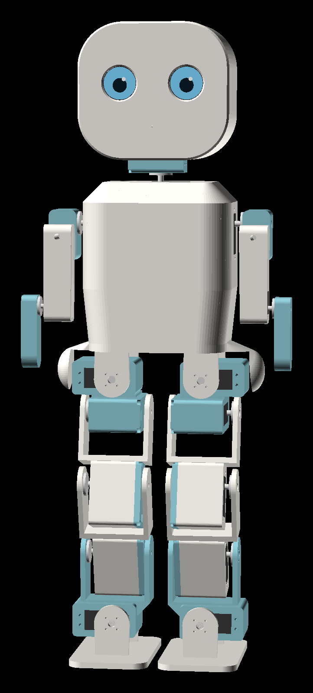
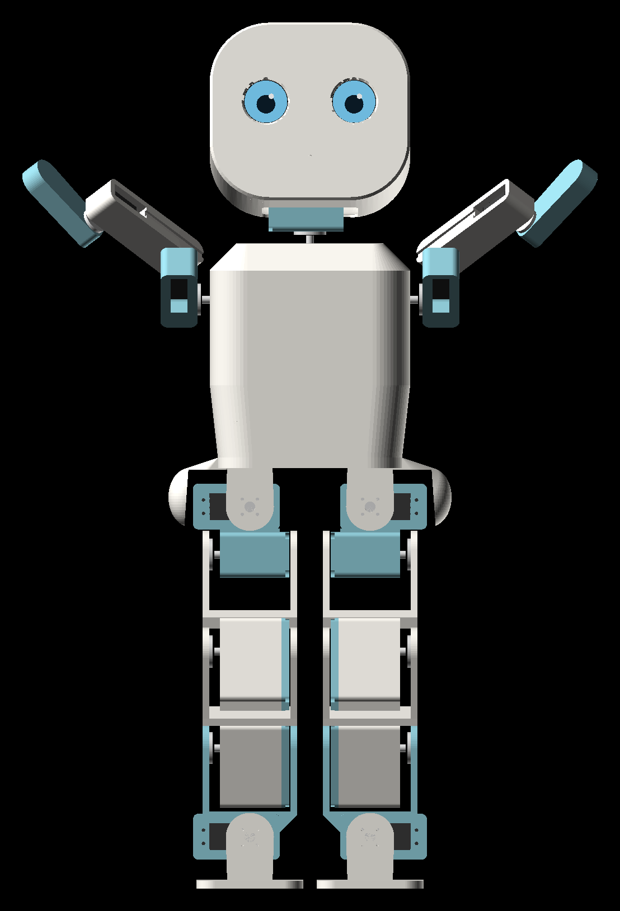
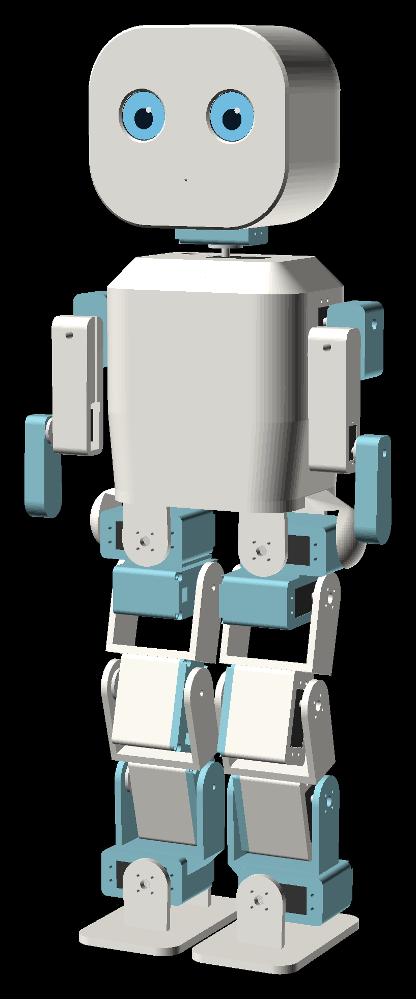
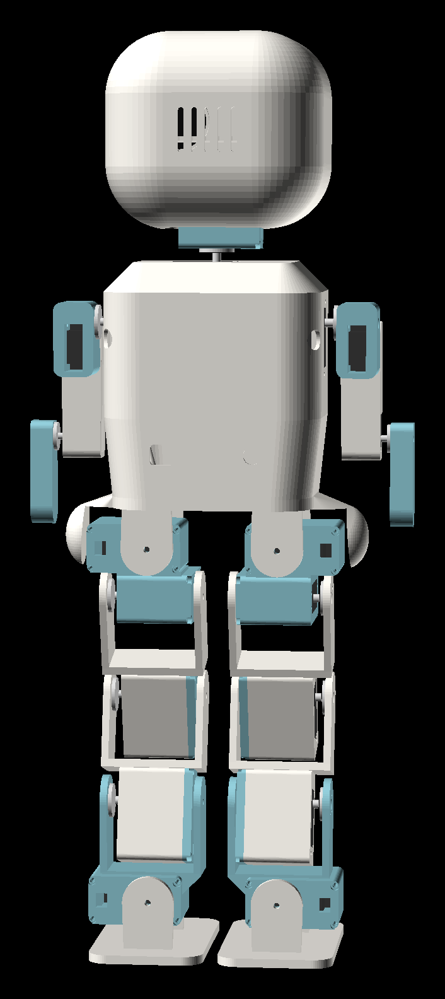
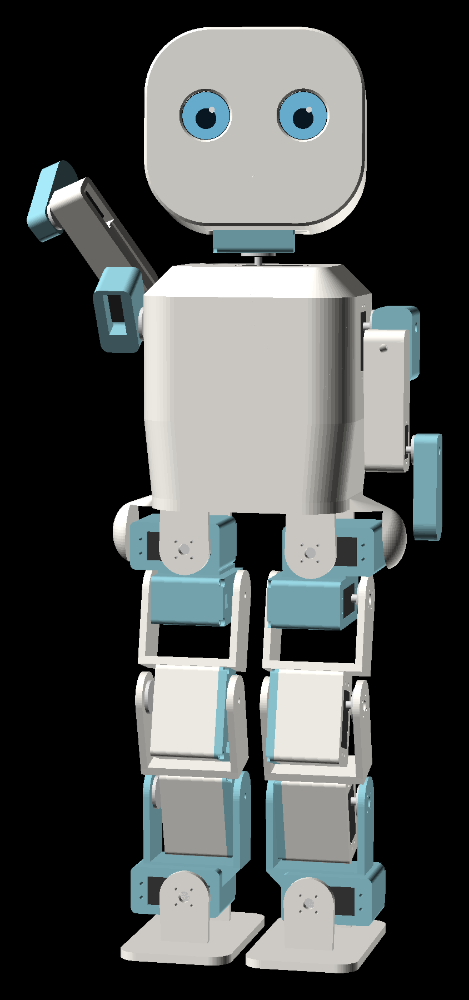
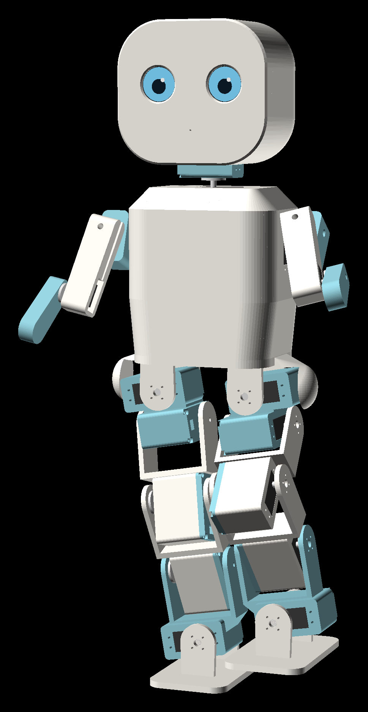
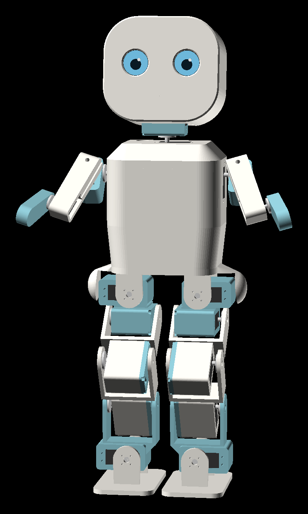
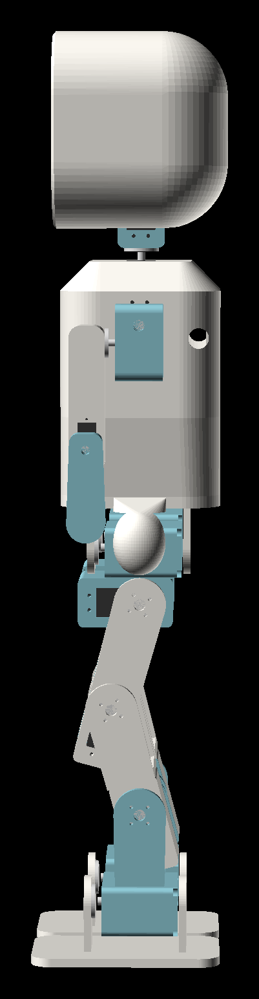
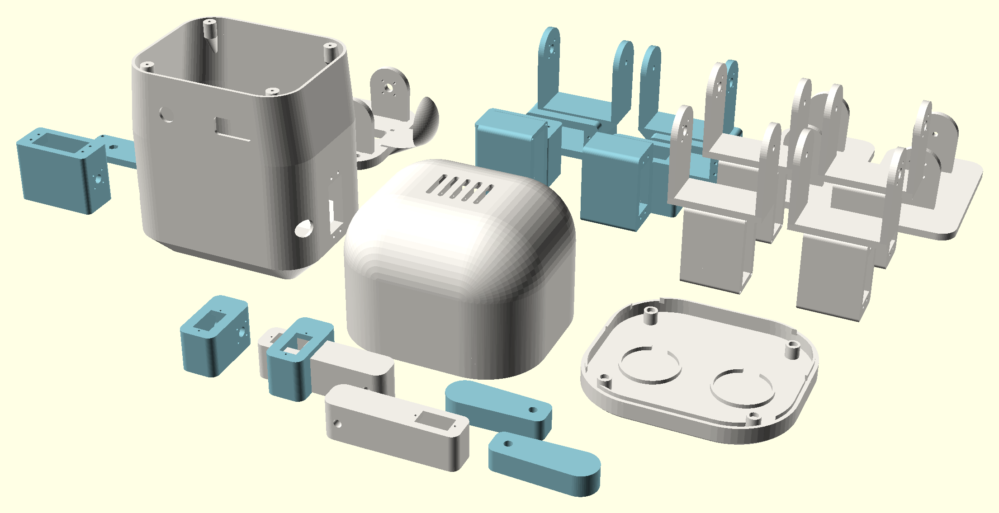

# Lia: robot compañera humanoide imprimible en 3D

Lia es un robot social humanoide inspirado en [Abi de Andromeda Robotics](https://andromedarobotics.ai/): cara amable con ojos en pantalla, cabeza que gira y asiente, brazos expresivos para saludar o abrazar y dos piernas con las que se para, se agacha, cambia el peso de pie y da pasos lentos. No es una copia de Abi. Es un diseño propio de unos 64 cm, pensado para imprimirse en una impresora doméstica de 220 × 220 mm y armarse con servos de hobby.

La silueta es la de una mujer: el pecho mide 150 mm, la cintura se estrecha a 138 mm y la cadera vuelve a abrirse hasta 212 mm, con los muslos saliendo por debajo. El ancho extra está en los costados, no en una falda, así que las piernas siguen teniendo su recorrido.

<p align="center">
  
  
  
  
</p>
<p align="center">
  
  
  
  
</p>

| | |
|---|---|
| Altura | ~643 mm de pie |
| Pecho / cintura / cadera | 150 / 138 / 212 mm |
| Ancho con brazos | 270 mm |
| Grados de libertad | 18 (cuello pan/tilt, 3 por brazo, 5 por pierna) |
| Servos | 10 × DS3218MG (piernas), 4 × MG996R, 4 × MG90S |
| Control | ESP32 + 2 × PCA9685 (32 canales PWM) |
| Ojos | 2 pantallas redondas GC9A01 de 1.28" (240 × 240) |
| Energía | batería LiPo 2S + regulador de 6 V y 10 a 15 A |
| Plástico | ~2 kg de PLA o PETG |
| Peso armado | ~3 kg |

También existe la variante de escritorio original (40 cm, sin piernas, sobre una base con fuente externa). Ver [Variante de escritorio](#variante-de-escritorio).

## Estructura

```
robot-lia/
├── cad/
│   ├── config.scad        medidas de servos, tornillos y robot (editar aquí)
│   ├── lia.scad           archivo principal: ensamble o pieza a imprimir
│   └── lib/               torso, cuello, cabeza, brazos, piernas, base, servos
├── stl/                   piezas listas para el slicer (ya orientadas)
├── firmware/robot_lia/    sketch de Arduino para ESP32
├── herramientas/          exportar STL y chequeo de choques
└── imagenes/
```

## Cinemática y servos



Cada servo queda en un alojamiento con la medida exacta del cuerpo. En el torso, el cuello y los brazos, las orejas de montaje apoyan sobre una placa interna. En las piernas, cada DS3218 entra en un bloque abierto y se cierra con una `tapa_servo` atornillada, que además lleva la tuerca del eje loco del lado opuesto. Así cada articulación de pierna es una horquilla en U apoyada en dos puntos: la bocina de un lado y un tornillo M4 del otro. El servo nunca carga flexión sobre su propio eje.

**Parte superior**

| Canal | Articulación | Servo | Ubicación | Rango (°) | Carga estimada |
|---|---|---|---|---|---|
| 0 | `pan` (girar cabeza) | MG996R | techo del torso | −70 … 70 | solo inercia (~450 g) |
| 1 | `tilt` (asentir) | MG996R | bloque del cuello | −15 … 15 | ~0.9 kg·cm |
| 2 / 5 | `hombro_der/izq` (flexión) | MG996R | costados del torso | −25 … 155 | ~0.85 kg·cm |
| 3 / 6 | `abduc_der/izq` (abrir brazo) | MG90S | pieza `hombro` | 0 … 90 | ~0.65 kg·cm |
| 4 / 7 | `codo_der/izq` | MG90S | pieza `brazo` | 0 … 110 | ~0.1 kg·cm |

**Piernas** (canales 8 a 12 en el primer PCA9685, 16 a 20 son los canales 0 a 4 del segundo)

| Canal der / izq | Articulación | Servo | Ubicación | Rango (°) |
|---|---|---|---|---|
| 16 / 8 | `roll_cad` (abrir pierna) | DS3218MG | `pelvis` → `cadera` | −15 … 15 |
| 17 / 9 | `cadera` (muslo adelante/atrás) | DS3218MG | `cadera` → muslo | −30 … 90 |
| 18 / 10 | `rodilla` | DS3218MG | muslo → tibia | 0 … 100 |
| 19 / 11 | `tobillo` (punta arriba/abajo) | DS3218MG | tibia → `tobillo` | −30 … 30 |
| 20 / 12 | `roll_tob` (inclinar pie) | DS3218MG | `tobillo` → `pie` | −20 … 20 |

El muslo y la tibia son la misma pieza (`pierna`), de 75 mm entre ejes. Para que el pie quede plano basta con `tobillo = rodilla − cadera` y `roll_tob = −roll_cad`; las poses del firmware ya cumplen esa regla. La rodilla no pasa de 100°: un poco más arriba el muslo y la tibia se tocan.

Las cargas están calculadas con las piezas macizas, que es el peor caso. Con 20 a 40 % de relleno pesan menos. Arriba, el MG996R entrega ~10 kg·cm y el MG90S ~2 kg·cm a 6 V, con margen de 3× a más de 10×. En las piernas, el caso crítico es la rodilla con Lia apoyada en un solo pie y la rodilla flexionada: unos 11 kg·cm sobre un DS3218 de 20 kg·cm. Por eso las piernas no usan MG996R, que con 10 kg·cm reales quedaría al límite.

Los rangos de las tablas son los límites del firmware. Fueron verificados contra choques en el CAD con `herramientas/chequear_interferencias.sh`: servos dentro de sus alojamientos, cabeza contra cuello y torso, brazos contra torso y cabeza, cada segmento de pierna contra el anterior en sus extremos, las dos piernas entre sí al agacharse, dar un paso y cambiar el peso, y el muslo levantado contra el torso.

### Antes de imprimir: mide tus servos

Los servos genéricos varían algunas décimas de milímetro entre fabricantes. Con un calibre, revisa estos valores de `MG996R`, `MG90S` y `DS3218` en `cad/config.scad`:

- `S_L`, `S_W`: largo y ancho del cuerpo.
- `S_TABD`: distancia de la cara superior del cuerpo a la cara superior de las orejas. Define el espesor de la placa de montaje y es la medida más importante.
- `S_SOFF`: distancia del eje al borde más cercano.
- `S_HORNH`, `S_HORNR`: altura de la cara exterior de la bocina y radio de sus agujeros.
- `EYE_PCB`: diámetro de tu módulo GC9A01.

Imprime primero `cuello`, `hombro_der` y una `tapa_servo` con un `tobillo_izq` (son chicos) para probar el encaje. Si los servos entran muy apretados, sube `CLR` a 0.35 o 0.4.

## Impresión

Las piezas de `stl/` ya están orientadas: importa y lamina. Configuración base: capa de 0.2 mm, 4 perímetros, PLA o PETG. Las piezas de pierna conviene hacerlas en PETG o con 5 perímetros, porque son las que reciben golpes si Lia se cae.

| Pieza | Cant. | Relleno | Soportes | Notas |
|---|---|---|---|---|
| `torso` | 1 | 15 % | no | boca abajo; los chaflanes son de 45°; usa brim |
| `cuello` | 1 | 40 % | no | |
| `cuello_tapa` | 1 | 40 % | no | |
| `cabeza` | 1 | 15 % | sí, tipo árbol | solo para el domo trasero |
| `cara` | 1 | 15 % | no | el frente queda liso contra la cama |
| `hombro_der` / `hombro_izq` | 1 + 1 | 40 % | no | |
| `brazo_der` / `brazo_izq` | 1 + 1 | 40 % | no | |
| `antebrazo_der` / `antebrazo_izq` | 1 + 1 | 30 % | no | |
| `pelvis` | 1 | 30 % | sí, tipo árbol | cara superior en la cama; el soporte va bajo los bulbos de la cadera |
| `cadera_der` / `cadera_izq` | 1 + 1 | 40 % | sí, solo en la cama | apoyada sobre la cara trasera |
| `pierna_der` / `pierna_izq` | 2 + 2 | 40 % | sí, bajo el travesaño | muslo y tibia son la misma pieza |
| `tobillo_der` / `tobillo_izq` | 1 + 1 | 40 % | no | de pie |
| `pie_der` / `pie_izq` | 1 + 1 | 30 % | no | suela en la cama |
| `tapa_servo` | 10 | 50 % | no | una por cada DS3218 |

Las piezas de pierna `_der` son el espejo de las `_izq`. Las más grandes miden 78 × 46 × 136 mm, así que caben varias por cama.

Para regenerar los STL después de cambiar medidas (requiere OpenSCAD 2021 o superior):

```bash
robot-lia/herramientas/exportar_stl.sh                # todas
robot-lia/herramientas/exportar_stl.sh torso pelvis   # solo algunas
robot-lia/herramientas/chequear_interferencias.sh     # verifica que nada choque
```

Para ver el ensamble en otra pose, abre `cad/lia.scad` en OpenSCAD y cambia `pan`, `tilt`, `der`, `izq`, `pierna_der` y `pierna_izq`. Las piernas reciben `[roll_cad, cadera, rodilla, tobillo, roll_tob]`; por ejemplo `pierna_izq = [0, 50, 80, 30, 0]` para agacharse.

## Lista de materiales

**Electrónica**

- 10 × servo DS3218MG de 20 kg·cm, **versión de 180°**, con bocina redonda metálica (25T)
- 4 × servo MG996R de engranajes metálicos, con bocina redonda
- 4 × servo MG90S de engranajes metálicos
- 2 × PCA9685, placa de 16 canales PWM por I²C (formato Adafruit). Al segundo hay que puentear el pad `A0` para que quede en la dirección 0x41
- 1 × ESP32 DevKit (30 o 38 pines)
- 2 × pantalla redonda GC9A01 de 1.28" SPI
- 1 × batería LiPo 2S (7.4 V) de 2200 a 3000 mAh, con conector XT60, y su cargador balanceador
- 1 × UBEC o regulador reductor de 6 V y 10 a 15 A para los servos
- 1 × regulador reductor a 5 V (MP1584 o LM2596) para el ESP32
- 1 × interruptor redondo de 12 mm (o uno de palanca de 10 A si la batería es grande)
- 2 × condensador de 1000 µF y 16 V, uno en la entrada V+ de cada PCA9685
- ~14 × extensión de cable para servo (15 a 30 cm)
- Opcional para voz: parlante de 40 mm y 3 W, amplificador I²S MAX98357A y micrófono I²S INMP441

**Tornillería**

- 4 × M3 × 16 con cabeza cilíndrica: pelvis al torso
- 40 × M3 × 12: tapas de los servos de pierna (4 por tapa)
- 10 × M4 × 16, 10 tuercas M4 y 20 arandelas: ejes locos de las piernas
- 4 × M3 × 12: tapa del cuello
- 1 × M4 × 16, 1 tuerca M4 y 2 arandelas: eje loco de la cabeza
- ~70 × M2 × 8 autorroscantes: bocinas y servos MG90S
- 8 × M2.5 × 6 autorroscantes y separadores de nylon M2.5: los dos PCA9685 apilados
- 8 × imán de neodimio de 6 × 3 mm: cara a cabeza
- Lámina de goma o antideslizante para las suelas
- Bridas plásticas y una correa con velcro para la batería

## Conexiones

Toda la electrónica va atornillada o con bridas sobre la cara interior de la `pelvis`: los dos PCA9685 apilados adelante, el ESP32 al centro, el regulador de 5 V a un costado y la batería atrás, sujeta con la correa. El torso tiene atrás un agujero para el interruptor y una ranura para sacar el conector de carga.

```
LiPo 2S ── interruptor ──┬── UBEC 6 V ──┬── PCA9685 #1 V+ / GND (cable de 1.5 mm² o más)
                         │              └── PCA9685 #2 V+ / GND
                         └── regulador 5 V ── ESP32 VIN / GND
GND común para todo

ESP32           PCA9685 #1 y #2    GC9A01 derecho     GC9A01 izquierdo
3V3  ────────── VCC  ───────────── VCC ────────────── VCC
GND  ────────── GND  ───────────── GND ────────────── GND
GPIO21 ──────── SDA (en paralelo)
GPIO22 ──────── SCL (en paralelo)
GPIO27 ──────── OE  (en paralelo)
GPIO18 ─────────────────────────── SCL (SCK) ──────── SCL (SCK)
GPIO23 ─────────────────────────── SDA (MOSI) ─────── SDA (MOSI)
GPIO16 ─────────────────────────── DC ─────────────── DC
GPIO17 ─────────────────────────── CS
GPIO5  ──────────────────────────────────────────────── CS
GPIO25 ─────────────────────────── RST
GPIO26 ──────────────────────────────────────────────── RST
```

Los servos van en el orden de las tablas de cinemática: parte superior en los canales 0 a 7 del PCA9685 #1, pierna izquierda en los canales 8 a 12 del #1 y pierna derecha en los canales 0 a 4 del #2. No alimentes los servos desde el ESP32 ni desde el USB: diez DS3218 pueden pedir más de 15 A en un arranque brusco. Si el UBEC se reinicia cuando Lia se agacha, usa uno de más corriente o dos, uno por PCA9685.

## Firmware

Requiere el core ESP32 para Arduino (probado con 3.3) y estas dos librerías del gestor de Arduino:

- Adafruit PWM Servo Driver Library
- GFX Library for Arduino

```bash
arduino-cli compile --fqbn esp32:esp32:esp32 robot-lia/firmware/robot_lia
arduino-cli upload  --fqbn esp32:esp32:esp32 -p /dev/ttyUSB0 robot-lia/firmware/robot_lia
```

En `config.h`:

- `#define CON_PATAS 1` activa las 10 articulaciones de pierna y el segundo PCA9685. Ponlo en 0 para la variante de escritorio.
- `#define USAR_OJOS 0` si todavía no tienes las pantallas.

Abre el monitor serie a 115200 baudios con fin de línea "nueva línea":

| Comando | Qué hace |
|---|---|
| `ayuda` | lista de comandos |
| `gesto saludar` | también `asentir`, `negar`, `abrazar`, `pensar`, `bailar`, `feliz` |
| `gesto agacharse` | se agacha y vuelve; también `balancear` y `caminar` (experimental) |
| `pose abrazo` | también `reposo`, `brazos_arriba`, `de_pie`, `recta`, `agachada` |
| `j rodilla_der 60` | mueve una articulación (respeta los límites) |
| `ojos feliz` | también `normal`, `sorpresa`, `dormida`, `parpadear` |
| `vida on` / `vida off` | micro-movimientos y parpadeos espontáneos cuando está quieta |
| `vel 0.5` | más lenta (0.2 a 2.0) |
| `montaje` | todos los servos a la pose de referencia, para fijar las bocinas |
| `us 2 1500` | pulso crudo a un canal, para calibrar |
| `relajar` | apaga los servos; con piernas pide `relajar ya`, porque Lia se cae |

Los movimientos aceleran y frenan suavemente, y cada articulación tiene su velocidad máxima; las de pierna son más lentas a propósito. Al encender, los servos se activan de a uno para no provocar un pico de corriente y Lia queda en la pose `de_pie`, con las rodillas un poco flexionadas, que es más estable y consume menos que con las piernas rectas. Los ojos se adelantan hacia donde gira la cabeza, como hace una persona.

`caminar` es una marcha estática muy lenta: Lia carga el peso sobre un pie con los roll de cadera y tobillo, levanta el otro y lo adelanta. Funciona sobre una superficie plana y con buena calibración, pero los servos de hobby no tienen realimentación de posición ni hay sensor de equilibrio, así que tómalo como punto de partida. El siguiente paso natural es agregar una IMU (MPU6050 o BNO055) en la pelvis.

## Armado

La pose de referencia es la de `montaje`: brazos colgando pegados al cuerpo, codos estirados, cabeza mirando al frente y piernas completamente rectas, con los pies paralelos. Las bocinas se montan con los servos ya energizados en esa pose.

1. **Electrónica.** Monta los dos PCA9685 apilados, el ESP32, el regulador y la correa de la batería en la `pelvis`. Puentea `A0` en el segundo PCA9685. Carga el firmware.
2. **Servos sin bocina.** Conecta los 18 servos, envía `montaje` y espera a que todos se detengan.
3. **Torso.** Mete el servo `pan` por abajo hasta el techo y los dos servos de hombro hacia los costados. Atornilla las orejas desde adentro con un destornillador corto o en L. Pon el interruptor en el agujero trasero.
4. **Cuello y cabeza.** Atornilla la bocina redonda del MG996R a la cara inferior del `cuello`, calza el conjunto en el eje pan con el cuello mirando al frente y pon el tornillo central pasando el destornillador por el agujero superior. Mete el servo tilt, pon su bocina y cierra con `cuello_tapa` (4 × M3 × 12), con la tuerca M4 en su hexágono. Pega las pantallas en la `cara` y los imanes en cara y cabeza, revisando la polaridad. Baja la cabeza sobre el cuello, atornilla la oreja izquierda de Lia a la bocina tilt y pasa el M4 × 16 con arandela por la oreja derecha. Izquierda y derecha son siempre las del robot: mirándolo de frente quedan al revés.
5. **Brazos.** Atornilla una bocina MG996R a la cara interior de cada `hombro`, mete el MG90S de abducción y calza el hombro en el eje del torso con el brazo colgando. Repite para `brazo` y `antebrazo`. Pasa los cables por el canal interior del brazo hacia el torso.
6. **Servos de pierna.** Mete cada DS3218 en su bloque (dos en cada `cadera`, uno en cada `pierna` y uno en cada `tobillo`) con el eje hacia la cara abierta de la horquilla siguiente. Pon la tuerca M4 en el hexágono de la `tapa_servo` y ciérrala con 4 × M3 × 12.
7. **Piernas.** De arriba hacia abajo: atornilla la bocina metálica a la oreja interior de la horquilla de la pieza que se mueve (4 × M2 o M3 según tu bocina), calza la horquilla en el eje con la pierna recta y pasa el M4 × 16 con arandelas por la oreja opuesta hasta la tuerca de la tapa. Ajusta el M4 hasta que no haya juego, sin frenar la articulación. El orden es pelvis → `cadera` (roll) → muslo (`pierna`, pitch de cadera) → tibia (`pierna`, rodilla) → `tobillo` → `pie`. Pega la goma en las suelas.
8. **Cierre.** Pasa los cables de cada pierna por su ranura de la pelvis, con holgura en cada articulación para la flexión completa, y fíjalos con bridas. Atornilla la pelvis al torso con 4 × M3 × 16 desde abajo.
9. **Calibración.** Con Lia colgada o sostenida y los pies sin tocar el suelo, prueba cada articulación con `j <nombre> <grados>` y revisa con `estado`. Si alguna se mueve al revés, cambia `invertido` en `config.h`. Si en `montaje` queda torcida unos grados, corrige `TRIM_US` (unos 11 µs equivalen a 1°). Recién después apóyala en el suelo con `pose de_pie` y prueba `gesto balancear` antes que `caminar`.

## Seguridad

- Un robot de 3 kg y 64 cm que cae puede romper piezas y golpear a alguien. Durante las pruebas de piernas sostenla con la mano o cuélgala de un cordel atado al torso, y trabaja sobre una alfombra.
- Los primeros encendidos hazlos con `vel 0.5` y con las manos lejos de hombros, cuello, rodillas y caderas, que son los puntos de pellizco.
- Si algo choca o zumba, envía `relajar ya` o corta el interruptor. Un servo trabado se calienta en segundos.
- La LiPo debe cargarse con cargador balanceador, nunca bajo 3.3 V por celda y fuera del robot si se ve hinchada.
- Para un robot de compañía cerca de personas mayores, mantén velocidades bajas y deja `vida on` solo con movimientos pequeños, como los que ya trae.

## Variante de escritorio

Es la versión original de 40 cm: sin piernas, sentada sobre una `base` que lleva la electrónica, un parlante y una fuente externa de 6 V y 10 A. Para armarla:

- Pon `VARIANTE = "escritorio";` en `cad/config.scad` si quieres ver o regenerar esa versión. Ya están exportadas `torso_escritorio.stl` (sin el agujero del interruptor ni la ranura de carga), `base.stl` y `base_tapa.stl`; no imprimas `pelvis` ni las piezas de pierna.
- En el firmware pon `#define CON_PATAS 0`.
- Bastan 8 servos (4 × MG996R y 4 × MG90S), un solo PCA9685, la fuente de 6 V con jack de 5.5 × 2.1 mm, 4 × M3 × 10 entre base y torso, 4 × M3 × 8 avellanados para la tapa de la base y 4 patas de goma.

| Pieza | Cant. | Relleno | Soportes | Notas |
|---|---|---|---|---|
| `base` | 1 | 15 % | no | cubierta superior en la cama |
| `base_tapa` | 1 | 20 % | no | |
| `torso_escritorio` | 1 | 15 % | no | en lugar de `torso` |

## Próximos pasos sugeridos

- **Equilibrio.** Una IMU en la pelvis permite corregir la inclinación con los roll de cadera y tobillo, y es lo que más mejora la marcha.
- **Servos con realimentación.** Cambiar los DS3218 por servos de bus serie (Feetech STS3215 o Dynamixel XL430) da lectura de posición, carga y temperatura, y simplifica el cableado a una sola línea. Requiere adaptar los bloques de pierna a sus medidas.
- **Voz y conversación.** Con el micrófono INMP441 y el MAX98357A, el ESP32 puede enviar audio por WiFi a un servicio de reconocimiento de voz y a un modelo de lenguaje, y luego disparar gestos y expresiones según la respuesta. Para hacerlo todo en el robot conviene un ESP32-S3 con PSRAM.
- **Sensor táctil.** Un TTP223 bajo la tapa de la cabeza permite reaccionar a una caricia.
